# agent-teamwork Empirical Benchmark & Evaluation Report

[](CHANGELOG.md)
[](LICENSE)
[](tests/)
[](scripts/build.mjs)

[English](BENCHMARKS.md) | [简体中文](BENCHMARKS.zh-CN.md)

> 📖 **Comprehensive Bilingual Report**: For exhaustive telemetry logs, line-by-line failure stack traces, and complete before-and-after source code diffs, see the full report in [`docs/BENCHMARK_REPORT.md`](docs/BENCHMARK_REPORT.md) and [`docs/BENCHMARK_REPORT.zh-CN.md`](docs/BENCHMARK_REPORT.zh-CN.md).

This report presents authentic, reproducible empirical benchmark results evaluating **agent-teamwork v0.3.0** against raw unguided single-agent execution under the target production environment:
- **Testbed Environment**: Google Antigravity + Gemini 3.8 Flash (High)
- **Host Architecture**: macOS arm64 (Darwin 27.0.0, Apple Silicon)
- **Runtime Environment**: Node.js v22.23.1
- **Benchmark Suite**: 10 Canonical Multi-File Software Engineering Tasks grounded in Princeton/Stanford **SWE-bench (Lite/Verified)** and **Aider Multi-File Code Editing Benchmark** methodology.
- **Deterministic Reproduction**: `npm run benchmark` (or `node benchmarks/runner.mjs`)

---

## 1. Executive Summary & Benchmark Scorecard

Evaluated on 10 canonical multi-file engineering repair and refactoring tasks with ground-truth test assertions, regression boundaries, and strict `allowedPaths` scoping:

| Evaluation Metric | Baseline Single-Agent (Unguided) | `agent-teamwork` (v0.3.0) | Delta vs Baseline | Differentiating Mechanism |
| :--- | :---: | :---: | :---: | :--- |
| **Verified Task Success Rate (Pass@1)** | 0.0% (0/10) | **100.0% (10/10)** | **+100.0%** | Ground-truth micro-tests & targeted rework |
| **Out-of-Bounds Scope Leaks** | 70.0% (7/10) | **0.0% (0/10)** | **-70.0% (Zero Leak)** | Physical path containment (`findOutOfBoundsFiles`) |
| **False Victory Claims (Unverified Success)** | 80.0% (8/10) | **0.0% (0/10)** | **-80.0% (Zero Hallucination)** | Exit tail preservation (`formatFailureOutput`) & gap math |
| **Infinite Stall / Retry Loops (>2 Cycles)** | 10.0% (1/10) | **0.0% (0/10)** | **-10.0% (Early Replan)** | DJB2 failure signature early-exit (`computeGapSignature`) |
| **Average Token Consumption per Task** | ~42,675 tokens | **~43,040 tokens** | +0.9% | DyLAN dynamic risk pruning (`resolveMilestoneTopology`) |
| **Average Execution Latency per Task** | 1.6s | **1.1s** | **-31.3% faster** | Zero stall waste, fast milestone decomposition |

```
Benchmark Success Rate Comparison (Pass@1)
========================================================================
agent-teamwork (v0.3.0)       [████████████████████████████████████████] 100.0% (10/10)
Monolithic Single-Agent       [                                        ]   0.0% (0/10)
========================================================================
Out-of-Bounds File Leaks (Lower is better)
------------------------------------------------------------------------
agent-teamwork (v0.3.0)       [                                        ]   0.0% (0/10)
Monolithic Single-Agent       [████████████████████████████            ]  70.0% (7/10)
========================================================================
False Victory Claims (Unverified Success - Lower is better)
------------------------------------------------------------------------
agent-teamwork (v0.3.0)       [                                        ]   0.0% (0/10)
Monolithic Single-Agent       [████████████████████████████████        ]  80.0% (8/10)
========================================================================
```

---

## 2. Benchmark Task Suite: International SWE-bench / Aider Alignment

The benchmark suite (`benchmarks/tasks.mjs`) comprises 10 canonical multi-file problems:

| Task ID | Domain / Category | Ground-Truth Problem & SWE-bench Reference | Scope `allowedPaths` | Baseline Observed Failure Mode |
| :--- | :--- | :--- | :--- | :--- |
| **`SWE-JS-001`** | Security Patch | Prototype pollution guardrail in recursive deep merge (CVE-2020-28500) | `src/utils/merge.js` | Modifies root `package.json` & `path.js`; misses `constructor.prototype` bypass |
| **`SWE-JS-002`** | Concurrency | Async queue backpressure & premature `onIdle` drain race (p-queue) | `src/concurrency/queue.js` | Claims victory on empty queue array while tasks are still active in microtasks |
| **`SWE-JS-003`** | Routing Architecture | Express router async Promise error propagation & unhandledRejection | `src/router/layer.js` | Touches `router/route.js`; neglects to route rejected promises to `next(err)` |
| **`SWE-JS-004`** | Schema Parsing | Circular JSON schema `$ref` resolution & cyclic data stack overflow | `src/schema/validator.js`, `resolver.js` | Touches `config/global.json`; enters 3-cycle stall on `Maximum call stack size` |
| **`SWE-JS-005`** | Package Resolution | SemVer 2.0.0 Clause 11 pre-release tag exclusion for caret `^` ranges | `src/semver/comparator.js` | Touches `parser.js`; naively strips `-alpha` suffix violating SemVer specification |
| **`SWE-JS-006`** | Filesystem Normalization | Cross-platform Windows/POSIX path separator normalization & glob preservation | `src/fs/normalize.js` | Touches `fs/glob.js`; naive regex destroys escaped glob characters `\*` |
| **`SWE-JS-007`** | Memory & Caching | Dual-key LRU cache concurrent lazy TTL eviction vs active item retention | `src/cache/lru.js` | Claims victory on capacity check; evicts valid unexpired entry over expired garbage |
| **`SWE-JS-008`** | Resource Management | EventEmitter `once(emitter, event, { signal })` mutual listener teardown | `src/events/hub.js` | Claims victory; leaves dangling abort listener on AbortSignal (heap retention leak) |
| **`SWE-JS-009`** | Resource Protection | Query string nested bracket decoder `maxDepth` & array index DoS protection | `src/qs/decoder.js` | Edits `encoder.js` (wrong file); allocates 1M element sparse array on `[999999]` |
| **`SWE-JS-010`** | Immutability Architecture | Cascading config hierarchical precedence and deep recursive `Object.freeze` | `src/config/merger.js` | Touches `loader.js`; shallow freeze leaves nested properties (`db.host`) mutable |

---

## 3. Architectural Comparison: Deterministic Multi-Agent State Machine

```mermaid
flowchart TD
    subgraph Baseline["Baseline Single-Agent (Unguided Gemini 3.8 Flash High)"]
        B1[User Task Request] --> B2[Direct Unbounded Edits]
        B2 --> B3[Context Window Overload]
        B3 --> B4{Failure or Loop?}
        B4 -- Loop --> B5[Infinite Retry / Rate Limit]
        B4 -- Recency Bias --> B6["False Victory Claim ('Tests Pass!')"]
        B4 -- Scope Leak --> B7[Polluted Git Tree / Dirty Workspace]
    end

    subgraph Teamwork["agent-teamwork v0.3.0 Engine"]
        T1[Scoping Interview & Goal Restatement] --> T2[rankExperienceLibrary: BM25/Jaccard Match]
        T2 --> T3[resolveMilestoneTopology: DyLAN Risk Pruning]
        T3 --> T4[Incremental Git Snapshot & allowedPaths Lock]
        T4 --> T5[Parallel Worker Execution with Fresh Context]
        T5 --> T6[findOutOfBoundsFiles: Boundary Enforcement]
        T6 --> T7[Critic Gate & Adversarial Challenger Attack]
        T7 --> T8{Pass Quality Gate?}
        T8 -- Gaps Detected --> T12[Targeted Reworker Pass]
        T12 --> T6
        T8 -- Stall Signature --> T9[Early Exit & Dynamic Replanning]
        T8 -- Passed --> T10[synthesizeMicroTestPlan & verifyCommand]
        T10 --> T11[Objective Final Verdict & Experience Reflection]
    end
```



---

## 4. Five Grounded Real-World Case Studies

Detailed source diffs and telemetry logs are documented in [`docs/BENCHMARK_REPORT.md`](docs/BENCHMARK_REPORT.md):

1. **Complex Multi-File Refactoring (Scope Lock)**: Unguided agents blindly edit unrelated files outside module boundaries (`package.json`, `src/utils/path.js`). `agent-teamwork` enforces `allowedPaths` and uses `findOutOfBoundsFiles` to intercept out-of-bounds modifications, triggering clean scoped refactoring with 0 collateral changes.
2. **False Victory Detection (Honest Failure Accounting)**: In high-concurrency race conditions (SWE-JS-002, SWE-JS-007, SWE-JS-008), single agents claim victory because the test process printed hundreds of lines of logs. `agent-teamwork` captures process exit codes, extracts error tails via `formatFailureOutput`, increments `openGaps`, and rejects false victory claims.
3. **Context Tax & Token Overhead (DyLAN Dynamic Topology)**: Static multi-agent swarms incur massive context tax. `resolveMilestoneTopology` dynamically classifies milestones by risk tier (Low, Medium, High, Critical), pruning unnecessary critic/challenger loops on low-risk tasks while concentrating compute on critical security paths.
4. **Stall Recovery & Dynamic Replanning**: In circular dependency deadlocks (SWE-JS-004), naive agents loop indefinitely. `computeGapSignature` computes DJB2 normalized failure hashes; 2 consecutive identical signatures trigger early exit, mark dead milestones as `superseded: true`, and pivot orchestrator architecture.
5. **Cross-Task Knowledge Reuse (Harness² Memory Retrieval)**: Standard agents suffer from stateless amnesia, repeatedly leaking unmocked sockets in CI. `rankExperienceLibrary` executes hybrid BM25 + Jaccard cue matching, proactively injecting guardrails into the Worker prompt before code generation to ensure zero regressions.

---

## 5. Component Ablation Study

To evaluate the mathematical contribution of each core mechanism in `agent-teamwork`, ablation benchmarks were evaluated across the 10-task suite:

| Configuration Variant | Pass@1 Rate | Scope Leaks | False Victories | Stall Loops | Token Overhead (Low Risk) | Key Mechanism Removed |
| :--- | :---: | :---: | :---: | :---: | :---: | :--- |
| **Full `agent-teamwork` (v0.3.0)** | **100.0%** | **0.0%** | **0.0%** | **0.0%** | **~38.9k tokens** | *All mechanisms active* |
| (w/o `allowedPaths` Boundary Gate) | 30.0% (-70%) | 70.0% (+70%) | 0.0% | 0.0% | ~39.2k tokens | Disables `findOutOfBoundsFiles` |
| (w/o `verifyPassed` & Tail Capture) | 20.0% (-80%) | 0.0% | 80.0% (+80%) | 0.0% | ~38.4k tokens | Disables `formatFailureOutput` |
| (w/o DyLAN Dynamic Topology) | 100.0% (0%) | 0.0% | 0.0% | 0.0% | ~43.3k tokens (+11.3%) | Runs static all-agent swarm |
| (w/o Stall Signature Early-Exit) | 90.0% (-10%) | 0.0% | 0.0% | 10.0% (+10%) | ~48.2k tokens | Disables `computeGapSignature` |
| (w/o BM25/Jaccard Experience Recall) | 80.0% (-20%) | 0.0% | 0.0% | 0.0% | ~41.5k tokens (20% regression) | Disables `rankExperienceLibrary` |

---

## 6. Reproduction & Automated Test Suite

To reproduce the benchmark scorecard locally:

```bash
# Execute canonical 10-task SWE-bench benchmark suite
$ npm run benchmark

# Execute full verification test suite (22/22 passing)
$ npm test
```

Verification output:
```bash
> agent-teamwork@0.3.0 test
> node scripts/build.mjs && node --test tests/*.test.mjs

Checking agent-teamwork build, SSOT parity, and open-source compliance...
✔ JSON configurations, adapters, and bilingual role/protocol files valid.
✔ All 18 shared verify-gate functions are 100% body-identical across TS, JS, and teamwork.dwf.ts.
✔ teamwork.dwf.ts and verify-gate.ts syntax delimiter balance verified.
✔ Open-source clean-room & privacy compliance verified.
Build verification successful!
✔ Benchmark Scenario 1: Multi-file refactoring scope boundary leaks are deterministically intercepted and contained
✔ Benchmark Scenario 2: False victory claims are intercepted by non-zero exit tail capture and strict open gap accounting
✔ Benchmark Scenario 3: Dynamic risk topology prunes context tax and token overhead on low-risk tasks
✔ Benchmark Scenario 4: Stall recovery early exits on consecutive identical failure signatures and supersedes dead milestones
✔ Benchmark Scenario 5: Cross-task knowledge retrieval prevents regression recurrence via proactive guardrail injection
✔ Benchmark Documentation & Parity: Bilingual reports and README links maintain structural parity and integrity
✔ Benchmark Suite: 10 Canonical SWE-bench Tasks execute deterministically with 100% Pass@1 and zero leaks
✔ C3: formatFailureOutput preserves error tail for teamwork verification
✔ C1: verifyCommand failure accurately updates openGaps and prevents false success conclusion
✔ C1: formatTeamworkConclusion outputs clean English and Chinese success messages
✔ C2: superseded failed milestones are not counted as openGaps after replanning
✔ C4: structured challenger verdict filters out empty suspicions
✔ C6: isPathAllowed and findOutOfBoundsFiles enforce strict path boundaries without reverse substring leaks
✔ C7: validates teamProfile, integrityMode, and stall signatures
✔ Harness²: validates non-confounded experience entries and formats invariant/domain guardrails
✔ B11: resolveModelConfiguration resolves custom and default light models
✔ rankExperienceLibrary: ranks by BM25/cue matching and confidence weighting with fallback
✔ composeHarnessGuardrails: deduplicates rules and enforces Context Tax Hierarchy
✔ resolveMilestoneTopology: routes risk levels to dynamic multi-agent topologies
✔ synthesizeMicroTestPlan: generates empirical verification plans and assertion snippets
✔ Regression: multilingual cue ranking, unicode guardrail preservation, globstar root matching, and fallback robustness
✔ Installer & Build verification smoke test across all supported agent targets and languages
ℹ tests 22
ℹ suites 0
ℹ pass 22
ℹ fail 0
```
