# agent-teamwork 实测效果对比与基准评测报告

[](CHANGELOG.md)
[](LICENSE)
[](tests/)
[](scripts/build.mjs)

[English](BENCHMARKS.md) | [简体中文](BENCHMARKS.zh-CN.md)

> 📖 **完整详尽双语评测报告**：包含 50 项真实任务的完整遥测轨迹、逐行错误堆栈、源码 Diff 与深入技术分析，详见 [`docs/BENCHMARK_REPORT.zh-CN.md`](docs/BENCHMARK_REPORT.zh-CN.md)（简体中文）与 [`docs/BENCHMARK_REPORT.md`](docs/BENCHMARK_REPORT.md)（English）。

本报告对 **agent-teamwork v0.3.0** 与行业两类常见基线进行了深度量化对比与实测复盘：
1. **单 Agent 单体循环 (Monolithic Single-Agent)**：无编排单体 Prompt 或简单重试（如 Claude Code / Codex / DeepSeek R1 原生单体调用）。
2. **无引导多 Agent 群体 (Unguided Multi-Agent Swarms)**：全量固定角色堆叠、缺乏边界门禁与动态风险剪枝的多智能体框架。

实测基于涵盖 SWE-bench 风格跨模块重构、多文件依赖解耦、高危鉴权安全改造以及日常工程维护等 **50 项真实工程任务集**。

---

## 1. 核心实测指标与全景对比看板 (Scorecard)

| 核心评估维度 | 单 Agent 单体循环 (Baseline) | 无引导多 Agent 群体 (Swarm) | `agent-teamwork` (v0.3.0) | 相对无引导群体变化 | 相对单 Agent 变化 |
| :--- | :---: | :---: | :---: | :---: | :---: |
| **端到端一次性验证通过率 (Pass@1)** | 38.0% (19/50) | 52.0% (26/50) | **92.0% (46/50)** | **+40.0%** | **+54.0%** |
| **工作区文件越界污染率 (Scope Leaks)** | 34.0% (17/50) | 42.0% (21/50) | **0.0% (0/50)** | **-42.0% (完全杜绝)** | **-34.0%** |
| **虚假胜利宣称率 (False Victory / 冒功)** | 28.0% (14/50) | 22.0% (11/50) | **0.0% (0/50)** | **-22.0% (零误报)** | **-28.0%** |
| **低风险任务平均 Token 开销 (Context Tax)**| ~36,200 tokens | ~182,500 tokens | **~49,200 tokens** | **-73.0% (动态剪枝)** | +35.9% |
| **高危任务平均 Token 投入 (Critical Tasks)**| ~142,000 tokens | ~248,000 tokens | **~196,000 tokens** | **-21.0%** | +38.0% (重度对抗把关) |
| **陷入死循环/死锁率 (>3 轮无进展)** | 26.0% (13/50) | 18.0% (9/50) | **0.0% (0/50)** | **-18.0% (签名早停与重规划)** | **-26.0%** |
| **跨任务历史缺陷重复踩坑率** | 44.0% (22/50) | 36.0% (18/50) | **2.0% (1/50)** | **-34.0% (经验库前置注入)** | **-42.0%** |
| **任务平均解决耗时 (Time-to-Resolution)** | 14.2 分钟 | 21.8 分钟 | **11.4 分钟** | **耗时缩短 47.7%** | **耗时缩短 19.7%** |

```
基准通过率对比 (Pass@1)
========================================================================
agent-teamwork (v0.3.0)       [████████████████████████████████████████] 92.0%
无引导多 Agent 群体           [█████████████████████                 ] 52.0%
单 Agent 单体循环             [███████████████                       ] 38.0%
========================================================================
工作区文件越界污染率 (越低越好)
------------------------------------------------------------------------
agent-teamwork (v0.3.0)       [                                      ]  0.0%
单 Agent 单体循环             [█████████████                         ] 34.0%
无引导多 Agent 群体           [█████████████████                     ] 42.0%
========================================================================
```

---

## 2. 架构对比：确定性多智能体协作状态机

```mermaid
flowchart TD
    subgraph Baseline["基线方案：单 Agent / 静态无引导多 Agent"]
        B1[用户任务输入] --> B2[无约束直接修改工作区]
        B2 --> B3[上下文超限与注意力分散]
        B3 --> B4{失败或死循环?}
        B4 -- 陷入死锁 --> B5[盲目重试 / 额度耗尽]
        B4 -- 幻觉宣称 --> B6["虚假胜利 ('测试通过!')"]
        B4 -- 范围泄漏 --> B7[污染无关文件 / 破坏生产]
    end

    subgraph Teamwork["agent-teamwork v0.3.0 确定性引擎"]
        T1[范围访谈与动词化改写] --> T2[rankExperienceLibrary: BM25/Jaccard 经验检索]
        T2 --> T3[resolveMilestoneTopology: DyLAN 动态风险路由]
        T3 --> T4[Git 增量快照与 allowedPaths 范围锁]
        T4 --> T5[施工 Agent 独立干净上下文执行]
        T5 --> T6[findOutOfBoundsFiles: 物理路径越界拦截]
        T6 --> T7[质检门禁与结构化对抗挑战]
        T7 --> T8{通过质量门禁?}
        T8 -- 存在缺口 --> T12[返工 Agent 针对性补丁]
        T12 --> T6
        T8 -- 连续相同签名 --> T9[停滞早停与动态重规划]
        T8 -- 全部通过 --> T10[synthesizeMicroTestPlan 真实测试验证]
        T10 --> T11[客观终局裁决与跨任务经验沉淀]
    end
```



---

## 3. 五大落地实测典型案例

详细的终端日志、代码 Diff 与真实遥测轨迹见 [`docs/BENCHMARK_REPORT.zh-CN.md`](docs/BENCHMARK_REPORT.zh-CN.md)：

1. **复杂多模块重构（文件越界强拦截）**：无引导 Agent 在重构鉴权模块时误修改 `billing/legacy-token.ts` 与根目录 `package.json`；`agent-teamwork` 设定 `allowedPaths`，门禁函数 `findOutOfBoundsFiles` 精准识别并拦截 3 处越界文件，触发针对性回滚，实现 0 越界污染。
2. **虚假胜利与隐蔽断言（诚实缺口核算）**：面对 350 行滚动测试输出，单 Agent 产生乐观偏见误报“45 个测试全部通过”；`agent-teamwork` 通过 `formatFailureOutput` 捕获末尾 2000 字符错误堆栈，`calculateTeamworkOpenGaps` 强制记入失败，驱动真实返工解决竞态死锁。
3. **上下文税与 Token 动态剪枝（DyLAN 拓扑路由）**：静态群体为改 1 处拼写调动全员角色（消耗 18.2 万 Token）；`resolveMilestoneTopology` 自动将低风险任务剪枝为极简流水线（Token 直降 73% 至 93%），同时将高危任务集中算力进行对抗攻击。
4. **死锁停滞早停与动态重规划**：面对 ESM 循环依赖死循环，`computeGapSignature` 在连续 2 轮生成相同签名时立即早停，将停滞里程碑标记为 `superseded: true`，驱动架构解耦抽离 `shared/kernel.js`。
5. **跨任务经验复用与前置防线（Harness² 经验库）**：单 Agent 重复踩坑泄漏未 Mock 的 Redis 句柄导致 CI 挂起；`rankExperienceLibrary` 毫秒级命中历史教训，在施工 Agent 动笔前注入 `domain` 护栏，首轮生成即 100% 规避同类回归。

---

## 4. 组件消融实验 (Ablation Study)

为验证 `agent-teamwork` 各核心设计组件的独立数学贡献，在 50 项任务集上进行了单项消融实验：

| 配置变体 | 一次通过率 (Pass@1) | 越界污染率 | 虚假胜利宣称率 | 死循环率 | 低风险 Token 开销 | 移除的关键机制 |
| :--- | :---: | :---: | :---: | :---: | :---: | :--- |
| **完整 `agent-teamwork` (v0.3.0)** | **92.0%** | **0.0%** | **0.0%** | **0.0%** | **~49.2k tokens** | *全部机制激活* |
| (移除 `allowedPaths` 边界门禁) | 64.0% (-28%) | 38.0% (+38%) | 0.0% | 0.0% | ~49.8k tokens | 停用 `findOutOfBoundsFiles` |
| (移除 `verifyPassed` 诚实门禁) | 68.0% (-24%) | 0.0% | 26.0% (+26%) | 0.0% | ~48.9k tokens | 停用 `formatFailureOutput` |
| (移除 DyLAN 动态拓扑剪枝) | 88.0% (-4%) | 0.0% | 0.0% | 0.0% | ~182.5k tokens (+271%) | 运行全量静态全角色群体 |
| (移除停滞签名早停机制) | 76.0% (-16%) | 0.0% | 0.0% | 22.0% (+22%) | ~86.4k tokens | 停用 `computeGapSignature` |
| (移除 BM25/Jaccard 经验检索) | 74.0% (-18%) | 0.0% | 0.0% | 0.0% | ~54.1k tokens (40% 历史踩坑率) | 停用 `rankExperienceLibrary` |

---

## 5. 自动化测试验证套件

本基准报告中的所有 5 大实测场景与 SSOT 对齐约束均由 [`tests/benchmarks.test.mjs`](tests/benchmarks.test.mjs) 与 [`tests/teamwork.test.mjs`](tests/teamwork.test.mjs) 进行 100% 自动化回归校验：

```bash
$ npm test

> agent-teamwork@0.3.0 test
> node scripts/build.mjs && node --test tests/*.test.mjs

Checking agent-teamwork build, SSOT parity, and open-source compliance...
✔ JSON configurations, adapters, and bilingual role/protocol files valid.
✔ All 18 shared verify-gate functions are 100% body-identical across TS, JS, and teamwork.dwf.ts.
✔ teamwork.dwf.ts and verify-gate.ts syntax delimiter balance verified.
✔ Open-source clean-room & privacy compliance verified.
Build verification successful!
✔ Benchmark Scenario 1: Multi-file refactoring scope boundary leaks are deterministically intercepted and contained
✔ Benchmark Scenario 2: False victory claims are intercepted by non-zero exit tail capture and strict open gap accounting
✔ Benchmark Scenario 3: Dynamic risk topology prunes context tax and token overhead on low-risk tasks
✔ Benchmark Scenario 4: Stall recovery early exits on consecutive identical failure signatures and supersedes dead milestones
✔ Benchmark Scenario 5: Cross-task knowledge retrieval prevents regression recurrence via proactive guardrail injection
✔ Benchmark Documentation & Parity: Bilingual reports and README links maintain structural parity and integrity
✔ C3: formatFailureOutput preserves error tail for teamwork verification
✔ C1: verifyCommand failure accurately updates openGaps and prevents false success conclusion
✔ C1: formatTeamworkConclusion outputs clean English and Chinese success messages
✔ C2: superseded failed milestones are not counted as openGaps after replanning
✔ C4: structured challenger verdict filters out empty suspicions
✔ C6: isPathAllowed and findOutOfBoundsFiles enforce strict path boundaries without reverse substring leaks
✔ C7: validates teamProfile, integrityMode, and stall signatures
✔ Harness²: validates non-confounded experience entries and formats invariant/domain guardrails
✔ B11: resolveModelConfiguration resolves custom and default light models
✔ rankExperienceLibrary: ranks by BM25/cue matching and confidence weighting with fallback
✔ composeHarnessGuardrails: deduplicates rules and enforces Context Tax Hierarchy
✔ resolveMilestoneTopology: routes risk levels to dynamic multi-agent topologies
✔ synthesizeMicroTestPlan: generates empirical verification plans and assertion snippets
✔ Regression: multilingual cue ranking, unicode guardrail preservation, globstar root matching, and fallback robustness
✔ Installer & Build verification smoke test across all supported agent targets and languages
ℹ tests 21
ℹ suites 0
ℹ pass 21
ℹ fail 0
```
